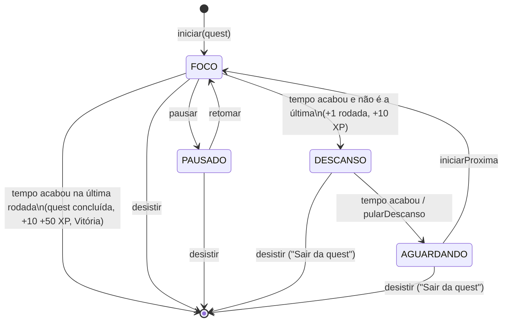

# Quest Pomodoro: como o app funciona

Documento de apoio à avaliação do trabalho de PDM. Ele descreve o que **está implementado** no código
(`app/src/main/java/com/exemplo/questpomodoro/`). Onde o código e a spec divergem, vale o código.

---

## 1. Visão geral

O Quest Pomodoro junta uma **lista de tarefas** com um **timer pomodoro**, usando um tema de **RPG pixel art**.
O usuário cadastra uma **Quest** (tarefa) e informa quantas **batalhas** (rodadas de foco) ela precisa. Cada batalha
é um período de foco (padrão de 25 min), e entre duas batalhas há uma **Pousada** (descanso, padrão de 5 min).
Durante o foco, um **Serviço de Acessibilidade** impede o uso dos apps que não estão liberados. O app mostra
notificações durante a sessão e no fim de cada fase, e envia um lembrete diário quando há quests pendentes.
Cada batalha vencida dá XP ao herói, que sobe de nível.

> **Exemplo: "Estudar Física, 5 batalhas"**
> 5 × 25 min de foco, com 4 × 5 min de pousada entre elas (não existe descanso depois da última batalha).
> O formulário mostra a prévia `5 batalhas = 125 min de foco + 20 min de pousada` (`QuestRegras.textoPrevia`).
> O progresso fica salvo por rodada: dá para vencer 2/5 hoje e as 3 restantes amanhã.

---

## 2. Fluxo do usuário

```text
Taverna ──[+ Nova Quest]──► Formulário ──[Salvar]──► Taverna
   │
   └─[⚔ na quest]──► (diálogo do Escudo, se a acessibilidade estiver desligada)
                         │
                         ▼
                   Batalha (FOCO) ──fim──► Pousada (DESCANSO) ──fim/Pular──► Aguardando
                         ▲                                                    │
                         └──────────────[Iniciar Batalha N/T]─────────────────┘
                   (última batalha) ──fim──► Taverna + diálogo de Vitória
```

| Tela | Arquivo | O que mostra / faz |
|---|---|---|
| **Taverna** (início) | `ui/taverna/TavernaScreen.kt` | Cabeçalho do herói (nível + barra de XP), faixa "⚔ Batalha em andamento — toque para voltar" quando existe uma sessão, filtros Todas/Pendentes/Concluídas, ordem por Raridade ou Mais recentes, cartões das quests (raridade, barra de progresso, botão ⚔) e o botão "+ Nova Quest". Na primeira abertura, pede `POST_NOTIFICATIONS` (Android 13+). |
| **Nova/Editar Quest** | `ui/quest/QuestFormScreen.kt` | Nome (obrigatório, até 60 caracteres), descrição, raridade (Comum/Rara/Épica = prioridade 1/2/3), stepper de batalhas (1–20, padrão 4), prévia calculada, Salvar e Excluir (com confirmação). Fica **somente leitura** quando a quest está concluída ou em batalha. |
| **Diálogo do Escudo** | `ui/bloqueio/EscudoUi.kt` (`DialogoEscudo`) | Aparece ao tocar em ⚔ se o serviço de acessibilidade estiver desligado. As opções são "Ativar bloqueio" (abre as configurações de Acessibilidade) ou "Batalhar sem bloqueio". |
| **Batalha** (FOCO/PAUSADO) | `ui/batalha/BatalhaScreen.kt` | "Batalha N/T", timer circular pixel, aviso "⚠ Bloqueio desativado" quando for o caso, Pausar/Retomar e Desistir. Na pausa, mostra "⏸ Pausado — apps liberados". |
| **Pousada** (DESCANSO) | mesma tela | Fogueira e caneca, timer, "Próxima: Batalha N/T", "Descanse! Os apps estão liberados.", Pular descanso e Sair da quest. |
| **Aguardando** | mesma tela | "A party descansou. Pronto para a próxima?", um botão grande "Iniciar Batalha N/T" e Sair da quest. |
| **Vitória** | `ui/taverna/VitoriaDialog.kt` | Diálogo em tela cheia na Taverna com troféu, "+X XP" e "LEVEL UP! NV n" quando o nível sobe. |
| **Configurações** | `ui/config/ConfiguracoesScreen.kt` | Duração do foco (1–60 min) e do descanso (1–30 min), atalho para os apps liberados, lembrete diário (liga/desliga + horário) e o status das permissões (acessibilidade e notificações) com o botão "Abrir". |
| **Apps liberados** | `ui/config/AppsLiberadosScreen.kt` | Lista dos apps com ícone na tela inicial (ícone + nome + checkbox), em ordem alfabética, sem o próprio app. |
| **Bloqueio** | `ui/bloqueio/BloqueioActivity.kt` | Mostra "Você não pode fugir da batalha!", o nome da quest, "Faltam mm:ss", "Voltar à batalha" e "Desistir". |

Quando o usuário toca numa notificação, a `MainActivity` abre com o extra `destino=batalha`, e a `Navegacao` leva
à rota `batalha`. A tela de Batalha volta sozinha para a Taverna quando a sessão termina (`encerrada = true`).

---

## 3. Máquina de estados da sessão

A lógica fica em `domain/SessaoMaquina.kt`. São funções **puras**, que recebem `agora` como parâmetro e por isso podem
ser testadas na JVM. O estado é a entidade `Sessao` (`domain/model/Sessao.kt`), e a fase é um destes valores:
`FOCO | PAUSADO | DESCANSO | AGUARDANDO`. "Sem sessão" corresponde a `null`.



**Regras implementadas:**

| Regra | Onde |
|---|---|
| A sessão começa na rodada `rodadasConcluidas + 1`, o que permite retomar uma quest em outro dia. | `SessaoMaquina.iniciar` |
| As durações (`focoMs`, `descansoMs`) são **capturadas no início da sessão**. Mudar as Configurações durante uma sessão não altera essa sessão. | `iniciar` / teste `configMudadaDuranteSessao_naoAfetaSessaoAtual` |
| **Não há descanso depois da última rodada.** Se `rodadaAtual >= rodadasTotais`, o fim do foco gera `QuestConcluida` e a sessão vira `null`. | `avancar` |
| Só dá para pausar no FOCO. Pausar guarda `restanteAoPausarMs` e apaga `faseTerminaEm`, e retomar calcula `faseTerminaEm = agora + restante`. O DESCANSO não tem pausa. | `pausar` / `retomar` |
| A pausa **libera os apps**, porque o bloqueio só age com `fase == FOCO`. | `RegrasBloqueio.deveBloquear` |
| O **fim do descanso espera o usuário**: DESCANSO passa para AGUARDANDO (sem `faseTerminaEm`), e só `iniciarProxima` volta ao FOCO. | `avancar` / `iniciarProxima` |
| **Desistir não conta a rodada atual.** No FOCO ou na PAUSA, grava um `BatalhaRegistro(concluida = false)` e apaga a sessão. As rodadas já vencidas ficam salvas, e não se perde XP. No DESCANSO ou em AGUARDANDO não há batalha em curso, então nada é registrado. | `SessaoRepository.desistir` |
| Com uma sessão ativa, não é possível iniciar outra, e a quest dela não pode ser editada nem excluída. | `SessaoRepository.iniciar`, `QuestRepository.salvar/excluir` |
| Transições que não se aplicam à fase atual (por exemplo, pausar no descanso) devolvem a mesma sessão. | todas as funções |

O texto de confirmação muda conforme a fase (`textoConfirmacaoDesistir`):
- FOCO/PAUSADO: "Tem certeza? A batalha atual não vai contar."
- DESCANSO/AGUARDANDO: "Sair da quest? Seu progresso (N/T) fica salvo."

---

## 4. Como o timer se mantém correto

1. **O tempo restante é derivado de timestamps e nunca é um contador.**
   ```kotlin
   Fase.FOCO, Fase.DESCANSO -> ((s.faseTerminaEm ?: agora) - agora).coerceAtLeast(0L)
   Fase.PAUSADO -> s.restanteAoPausarMs ?: 0L
   ```
   A UI só "tica" a cada 1 s (`BatalhaViewModel.tiquePadrao`) para recalcular esse valor. Por isso recomposição,
   rotação e tela apagada não aceleram nem reiniciam o timer.

2. **Fases expiradas são aplicadas em cadeia.** `SessaoMaquina.avancar(s, agora)` aplica todas as fases que já
   terminaram. Se o foco e o descanso expiraram enquanto o app estava fechado, a sessão vai direto para AGUARDANDO,
   com os eventos `BatalhaConcluida` e `DescansoTerminou`. O repositório posta **um único alerta**, o do último evento.

3. **Alarme exato no fim da fase.** `service/AgendadorAlarme.kt` mantém um único alarme
   (`setExactAndAllowWhileIdle`, `RTC_WAKEUP`) para `faseTerminaEm`. Se o alarme exato não for permitido, usa
   `setAndAllowWhileIdle`. O `FaseAlarmReceiver` chama `sessaoRepository.sincronizar()`. Quando a sessão muda
   (`SessaoEfeitosAndroid.aoMudarSessao`), o alarme é reagendado ou cancelado (por exemplo, na pausa e no AGUARDANDO).

4. **A UI também serve de reserva para o alarme.** Quando o tempo chega a zero na tela, o `BatalhaViewModel` chama
   `sincronizar()` uma vez para cada fim de fase (`ultimoFimSincronizado`).

5. **Um Mutex no repositório.** O alarme, a UI e as ações da notificação podem chamar o repositório ao mesmo tempo.
   Por isso todas as operações do `SessaoRepository` rodam sob um único `Mutex`, e toda operação começa por
   `avancarInterno()`, que resolve as fases expiradas. Assim, cada fim de fase é contado **exatamente uma vez**.
   Os efeitos (rodada, histórico, XP, vitória e a nova sessão) são gravados dentro de uma **transação Room**
   (`Transacionador` → `db.withTransaction`).

6. **Recuperação após morte do processo, force-stop ou boot.** A sessão fica persistida no Room (`sessao_ativa`), e
   `AppContainer.restaurarSessao()` aplica as fases expiradas e reagenda o alarme e o serviço. Ela é chamada:
   - em `MainActivity.onStart()`, o que cobre a reabertura do app depois de um force-stop, já que o force-stop cancela os alarmes;
   - no `BootReceiver` (`BOOT_COMPLETED` e `MY_PACKAGE_REPLACED`), que também reagenda o lembrete diário.

   O `SessaoService` devolve `START_STICKY`.

---

## 5. Bloqueio de apps

**Serviço:** `service/BloqueioAccessibilityService.kt`, configurado em `res/xml/bloqueio_accessibility.xml`.
O serviço ouve **apenas** `typeWindowStateChanged` e declara `canRetrieveWindowContent="false"`, ou seja, sabe
**qual app** veio para a frente, mas não lê o conteúdo da tela. O nome que aparece nas configurações do Android é
"Escudo Anti-Distração (Quest Pomodoro)".

**Funcionamento:**
1. Em `onServiceConnected`, o serviço monta a lista de pacotes sempre liberados e passa a observar (por Flow) a fase da
   sessão e os apps liberados pelo usuário.
2. A cada troca de janela, chama `deveBloquear(pacote, fase, liberados, sempreLiberados)`, de `domain/RegrasBloqueio.kt`.
   Essa função devolve `true` **somente** se a fase for `FOCO`, o pacote for conhecido e ele não estiver em nenhuma
   das duas listas.
3. Se deve bloquear, abre a `BloqueioActivity`, com no máximo um disparo a cada 500 ms.

**Sempre liberados** (`PACOTES_SISTEMA_LIBERADOS` + `service/SempreLiberados.kt`):

| Grupo | Pacotes / origem |
|---|---|
| Sistema | `com.android.systemui` (e subpacotes), `com.android.settings`, `permissioncontroller` (Android/Google) |
| Chamadas e emergência | `com.android.phone`, `server.telecom`, `incallui`, `com.android.dialer`, `com.google.android.dialer`, `com.android.emergency`, `com.google.android.apps.safetyhub`, além do **discador padrão** (`TelecomManager.defaultDialerPackage`) |
| Dinâmicos | o próprio app, os **launchers** (intent `HOME`) e o **teclado ativo** (`DEFAULT_INPUT_METHOD`) |

**Lista do usuário:** é escolhida em Configurações → Apps liberados e salva no DataStore (`apps_liberados`).

**Tela de bloqueio** (`BloqueioActivity`, `singleTask`, `excludeFromRecents`):
- "Voltar à batalha" e o botão Voltar do sistema abrem a `MainActivity` na rota da batalha.
- "Desistir" mostra a mesma confirmação da tela de batalha e chama `sessaoRepository.desistir()`.
- A tela se fecha sozinha se a fase deixar de ser FOCO (pausa, fim do foco ou desistência).

**Bloqueio desativado:** a batalha funciona normalmente, mas exibe o aviso "⚠ Bloqueio desativado — outros apps estão
liberados." Para saber se o serviço está ativo, `BloqueioStatus.ativo()` lê `Settings.Secure.ENABLED_ACCESSIBILITY_SERVICES`
com a função pura `servicoAcessibilidadeAtivo`.

---

## 6. Notificações

**Canais** (`notification/Canais.kt`, criados em `QuestApp.onCreate`):

| ID do canal | Nome | Importância | Uso |
|---|---|---|---|
| `batalha` | Batalha em andamento | LOW, sem badge | Notificação contínua do foreground service |
| `alertas` | Alertas de fase | HIGH, vibração | Fim do foco, fim do descanso, vitória |
| `lembretes` | Lembrete diário | DEFAULT | Quests pendentes |

**Notificação contínua** (`SessaoService` + `conteudoContinuo`, ID 1). O título é o nome da quest, e o texto muda
conforme a fase:

| Fase | Texto | Extra |
|---|---|---|
| FOCO | `⚔️ Batalha 2/5` | cronômetro nativo em contagem regressiva até `faseTerminaEm` |
| PAUSADO | `⏸ Batalha pausada — 12:40 restantes` | ação **Retomar** |
| DESCANSO | `🍺 Pousada — próxima: Batalha 3/5` | cronômetro regressivo |
| AGUARDANDO | `Pronto para a Batalha 3/5` | ação **Iniciar** |

O `SessaoService` (tipo `specialUse` no Android 14+) observa a sessão e o título da quest. Quando a sessão vira `null`,
ele remove a notificação e se encerra.

**Alertas de fase** (`conteudoAlerta`, ID 2, com som e vibração):

| Evento | Título | Texto |
|---|---|---|
| Fim do foco | Hora da Pousada! 🍺 | `Batalha 1/5 vencida em Estudar Física.` |
| Fim do descanso | De volta à batalha! ⚔️ | `Estudar Física — Batalha 2/5 te espera.` + ação **Iniciar** |
| Última batalha | Vitória! 🏆 | `Última batalha de Estudar Física vencida.` |

O alerta "De volta à batalha!" é cancelado assim que o FOCO recomeça.

**Ações:** os botões Retomar e Iniciar disparam o `SessaoAcaoReceiver`, que chama `retomar()` ou `iniciarProxima()`
no repositório. O usuário não precisa abrir o app para isso. Tocar em qualquer notificação abre a tela da batalha.

**Lembrete diário** (`notification/Lembrete.kt`), feito com **AlarmManager**, não WorkManager:
- `LembreteAgendador.reagendar()` agenda um único alarme (exato quando permitido) para o próximo horário configurado
  (padrão 19:00), usando `atrasoAteProximo`, que escolhe hoje ou amanhã.
- O `LembreteReceiver` conta as quests pendentes e, se houver alguma, posta "Sua party te espera: N quests pendentes."
  (`textoLembrete`). Em seguida, agenda o dia seguinte.
- O lembrete é reagendado ao abrir o app (`QuestApp`), ao mudar a configuração e no boot. Desligá-lo cancela o alarme.

Sem a permissão de notificação, `Notificador.postar` não faz nada, e o app continua funcionando.

---

## 7. Gamificação

As regras ficam em `domain/Heroi.kt`, e o XP é aplicado em `SessaoRepository.avancarInterno`.

| Regra | Valor |
|---|---|
| Batalha vencida | **+10 XP** |
| Bônus ao concluir a quest | **+50 XP** |
| Nível | `1 + XP / 100` |
| Barra de XP | `XP % 100` |
| Desistir | não tira XP |

**Vitória:** quando a última batalha termina, a quest recebe `concluida = true` e `dataConclusao`, e uma `Vitoria` é
gravada no DataStore com o título, o XP ganho, o nível anterior e o novo nível. O XP ganho mostrado é
`rodadasTotais × 10 + 50`, ou seja, o total que a quest rendeu. Quando a Taverna volta, ela exibe o `VitoriaDialog`,
e ao tocar em "Continuar" a vitória é apagada (`limparVitoria`). Como a vitória fica persistida, o diálogo aparece
mesmo se a quest terminar com o app fechado.

---

## 8. Arquitetura e organização de pastas

- **MVVM:** as telas Compose observam `StateFlow`s dos ViewModels, que usam os repositórios, que por sua vez usam os
  DAOs do Room e os stores do DataStore.
- **Camadas:** `domain/` é Kotlin puro (regras testáveis na JVM), `data/` cuida da persistência e da orquestração,
  `service/` e `notification/` contêm os componentes Android, e `ui/` tem as telas e os ViewModels.
- **DI manual:** não há Hilt. O `AppContainer` cria tudo uma vez (é instanciado em `QuestApp.onCreate`), e qualquer
  `Context` acessa esses objetos por `context.container`. Os ViewModels são criados com `viewModelFactory { initializer { … } }`.
- **Efeitos Android ficam atrás de interfaces:** `SessaoEfeitos` (alarme, serviço, alertas), `Transacionador` e
  `Relogio`. Com isso, o `SessaoRepository` pode ser testado com fakes.

| Arquivo | Responsabilidade |
|---|---|
| `QuestApp.kt` | `Application`: cria o `AppContainer`, os canais e agenda o lembrete |
| `AppContainer.kt` | DI manual: banco, stores, relógio, escopo, repositórios e `restaurarSessao()` |
| `MainActivity.kt` | Host do Compose, lê o destino da notificação e restaura a sessão em `onStart` |
| `domain/SessaoMaquina.kt` | Máquina de estados pura e cálculo do tempo restante |
| `domain/model/Sessao.kt` | Entidade `sessao_ativa`, `Fase`, `EventoSessao` e `Transicao` |
| `domain/model/Quest.kt`, `BatalhaRegistro.kt`, `Prioridade.kt`, `Vitoria.kt` | Modelos e entidades |
| `domain/QuestRegras.kt` | Validação, prévia "N batalhas = …", filtros e ordenação |
| `domain/Heroi.kt` | XP e nível |
| `domain/RegrasBloqueio.kt` | `deveBloquear`, pacotes do sistema e checagem do serviço ativo |
| `domain/Lembrete.kt` | Atraso até o próximo horário e texto do lembrete |
| `domain/Tempo.kt` | `Relogio` e `formatarTempo` (mm:ss arredondado para cima) |
| `data/local/*` | `AppDatabase` e os DAOs de quests, batalhas e sessão |
| `data/prefs/*` | `Configuracoes`, `ConfiguracoesStore` e `HeroiStore` (DataStore) |
| `data/repository/QuestRepository.kt` | CRUD de quests com validação e bloqueio enquanto a quest está em sessão |
| `data/repository/SessaoRepository.kt` | Orquestra a sessão (Mutex, transação, XP, histórico, alertas) |
| `data/repository/SessaoEfeitos.kt` | Interfaces `SessaoEfeitos`, `Alerta` e `Transacionador` |
| `service/SessaoEfeitosAndroid.kt` | Implementação real: alarme, foreground service e alertas |
| `service/AgendadorAlarme.kt` | Alarme exato do fim da fase |
| `service/SessaoService.kt` | Foreground service da notificação contínua |
| `service/Receivers.kt` | `FaseAlarmReceiver`, `BootReceiver` e `SessaoAcaoReceiver` |
| `service/BloqueioAccessibilityService.kt` | Detecta o app em primeiro plano e abre o bloqueio |
| `service/SempreLiberados.kt` | Monta a lista de sempre liberados e o `BloqueioStatus` |
| `notification/Canais.kt`, `Notificador.kt` | Canais, IDs e construção e envio das notificações |
| `notification/ConteudoNotificacao.kt` | Textos das notificações, independentes do Android |
| `notification/Lembrete.kt` | `LembreteAgendador` (AlarmManager) e `LembreteReceiver` |
| `ui/Navegacao.kt` | NavHost (`taverna`, `quest/{id}`, `batalha`, `config`, `config/apps`) e diálogo do Escudo |
| `ui/taverna`, `ui/quest`, `ui/batalha`, `ui/config` | Telas e ViewModels |
| `ui/bloqueio/*` | `BloqueioActivity`, aviso e diálogo do Escudo |
| `ui/components/Pixel.kt`, `Sprites.kt` | Painel, botão e timer em estilo pixel, e 6 sprites 16×16 desenhados em código |
| `ui/theme/Tema.kt` | Paleta Sweetie 16 e fonte Press Start 2P nos títulos |

---

## 9. Persistência

**Room** (`quest.db`, versão 1):

| Tabela | Entidade | Campos |
|---|---|---|
| `quests` | `Quest` | `id`, `titulo`, `descricao`, `prioridade` (1–3), `rodadasTotais`, `rodadasConcluidas`, `concluida`, `dataCriacao`, `dataConclusao` |
| `batalhas` | `BatalhaRegistro` | `id`, `questId`, `inicio`, `fim`, `concluida` (`false` = desistência) |
| `sessao_ativa` | `Sessao` | linha única `id = 0`: `questId`, `rodadasTotais`, `fase`, `rodadaAtual`, `faseIniciadaEm`, `faseTerminaEm`, `restanteAoPausarMs`, `focoMs`, `descansoMs` |

**DataStore Preferences** (arquivo `quest_prefs`):

| Chave | Tipo | Padrão |
|---|---|---|
| `foco_min` | Int | 25 (faixa 1–60) |
| `descanso_min` | Int | 5 (faixa 1–30) |
| `apps_liberados` | Set\<String\> | vazio |
| `lembrete_ativo` | Boolean | true |
| `lembrete_hora` / `lembrete_minuto` | Int | 19 / 0 |
| `xp` | Int | 0 |
| `vitoria_quest_id`, `vitoria_titulo`, `vitoria_xp`, `vitoria_nivel_antes`, `vitoria_nivel_depois` | Long/String/Int | ausentes (= sem vitória pendente) |

Os valores lidos passam por `Configuracoes.normalizada()`, que limita as faixas.

---

## 10. Testes automatizados

São 101 testes unitários na JVM (`app/src/test/...`) e 3 testes instrumentados. Os testes de repositório e ViewModel
usam fakes (`fakes/Fakes.kt`, `fakes/Repos.kt`) e um relógio controlável (`FakeRelogio`).

| Classe | Testes | O que garante |
|---|---|---|
| `domain/SessaoMaquinaTest` | 11 | Início na próxima rodada, pausa que congela o tempo e retomada que recalcula o fim, que não há pausa no descanso, foco → descanso, última rodada sem descanso, foco e descanso expirados em cadeia até AGUARDANDO, PAUSADO que nunca expira, pular descanso e iniciar a próxima, restante nunca negativo |
| `data/SessaoRepositoryTest` | 18 | Início único (inclusive com chamadas concorrentes), recusa de quest concluída ou inexistente, fim do foco que conta a rodada, grava o histórico, dá XP e alerta, vitória com level up, **sincronizações concorrentes aplicadas uma vez só**, um único alerta para fases encadeadas, desistência no foco/pausa (registro não concluído) e no descanso (sem registro), configuração congelada durante a sessão, pausar depois do fim primeiro avança |
| `data/QuestRepositoryTest` | 8 | Validação, trim e data de criação, edição que preserva o progresso, rodadas abaixo do já concluído, edição/exclusão recusadas na quest em sessão e na quest concluída |
| `domain/QuestRegrasTest` | 12 | Limites do título (vazio, 60, 61), rodadas 0 e 21, prévia de 5 e de 1 rodada, filtros e ordenações |
| `domain/RegrasBloqueioTest` | 8 | Bloqueia só no FOCO, respeita a lista do usuário, o próprio app, chamadas, SystemUI e pacote nulo, e lê o serviço nos formatos completo e curto |
| `domain/HeroiTest`, `domain/TempoTest` | 2 + 1 | Nível e XP no nível, formato mm:ss |
| `domain/LembreteTest` | 5 | Antes do horário (hoje), depois ou exatamente no horário (amanhã), minutos, textos de 0/1/N pendentes |
| `notification/ConteudoNotificacaoTest` | 7 | Texto, cronômetro e ação da notificação contínua em cada fase, e os três alertas |
| `data/ConfiguracoesTest` | 3 | Normalização das faixas e padrões 25/5/19:00 |
| `ui/BatalhaViewModelTest` | 6 | Restante e progresso, pausa congelada, **sincroniza ao chegar a zero mesmo sem alarme**, ações delegadas, sessão nula = encerrada, texto da desistência por fase |
| `ui/TavernaViewModelTest` | 6 | Filtro, sessão ativa exposta, XP 250 = nível 3, iniciar com e sem sessão ativa, mostrar e dispensar a vitória |
| `ui/QuestFormViewModelTest` | 9 | Prévia com as durações da configuração, padrões, erros, edição, somente leitura (concluída ou em sessão), stepper limitado pelo concluído, exclusão |
| `ui/ConfiguracoesViewModelTest` | 3 | Normalização, alternar app liberado, callback de reagendar o lembrete |
| `ui/SpritesTest` | 1 | Os 6 sprites têm 16×16 e todas as cores existem na paleta |
| `SanidadeTest` | 1 | Teste de sanidade do ambiente |
| `androidTest/data/DaoTest` | 3 | (instrumentado, Room em memória) inserir e buscar quest, sessão com linha única, contagem de pendentes |

Para rodar: `./gradlew :app:testDebugUnitTest`.

---

## 11. Permissões e por quê

| Permissão (Manifest) | Por quê |
|---|---|
| `POST_NOTIFICATIONS` | Notificação contínua, alertas e lembrete. É pedida em tempo de execução na Taverna (Android 13+). |
| `FOREGROUND_SERVICE` + `FOREGROUND_SERVICE_SPECIAL_USE` | `SessaoService` com `foregroundServiceType="specialUse"` (subtipo: "Timer de foco pomodoro com bloqueio de distrações"). |
| `USE_EXACT_ALARM` e `SCHEDULE_EXACT_ALARM` (`maxSdkVersion=32`) | Disparar o fim da fase e o lembrete na hora certa, mesmo em Doze. |
| `RECEIVE_BOOT_COMPLETED` | `BootReceiver` reagenda a sessão e o lembrete depois de reiniciar o aparelho. |
| `BIND_ACCESSIBILITY_SERVICE` | Protege o `BloqueioAccessibilityService`, para que só o sistema possa se ligar a ele. O usuário precisa ativá-lo nas configurações. |
| `<queries>` `MAIN/HOME` e `MAIN/LAUNCHER` | Android 11+: identificar os launchers (sempre liberados) e listar os apps na tela de Apps liberados. |
